<!-- ===================================================================== -->
<!-- 1. 顶部动态主视觉 (Hero Section)                                       -->
<!-- ===================================================================== -->

  <!-- 动态打字机标题 (Fira Code 等宽字体 · 冰川蓝 #38BDF8 · 循环轮播) -->
  

  <!-- 一句话简介 -->
  

    专注于 <b>全栈 Web 工程</b>、<b>Cloudflare 边缘计算</b>、<b>AI 智能体与量化自动化系统</b>，追求极简架构与高可靠交付。
  

   

  <!-- 社交导航胶囊 (for-the-badge 扁平化深色徽章) -->
  

    
    &nbsp;
    
    &nbsp;
    
    <!-- 其他社交平台导航（取消下方注释并替换为你的账号即可启用）：
    &nbsp;
    
    &nbsp;
    
    &nbsp;
    
    -->
  

 

<!-- ===================================================================== -->
<!-- 2. 技术栈矩阵 (Tech Stack Matrix · 3 行分层居中)                        -->
<!-- ===================================================================== -->

  <!-- 第一行：核心编程语言 -->
  

    
    
    
    
  

  <!-- 第二行：前后端开发框架 -->
  

    
    
    
    
    
  

  <!-- 第三行：云原生、数据库与运维工具 -->
  

    
    
    
    
  

 

<!-- ===================================================================== -->
<!-- 3. 数据统计看板 (GitHub Stats · Tokyo Night · 无边框 · #0D1117 背景)   -->
<!-- ===================================================================== -->

  <!-- 第一排：并排双卡（左：综合数据概览卡 / 右：Compact 常用语言分布卡） -->
  

    
    &nbsp;
    
  

  <!-- 第二排：单卡居中（连续提交记录卡 Streak Stats） -->
  

    
  

 

<!-- ===================================================================== -->
<!-- 4. 底部格言与动态彩蛋 (Footer & Gamification)                          -->
<!-- ===================================================================== -->

  

    <i>"Automate the routine, architect for the edge, and keep the system simple."</i>
  

  <!-- 贪吃蛇贡献图动画（自动跟随 GitHub 浅色/深色主题切换，资产隔离在 output 分支） -->
  <picture>
    <source media="(prefers-color-scheme: dark)" srcset="https://raw.githubusercontent.com/Yaniuan/Yaniuan/output/github-contribution-grid-snake-dark.svg" />
    <source media="(prefers-color-scheme: light)" srcset="https://raw.githubusercontent.com/Yaniuan/Yaniuan/output/github-contribution-grid-snake.svg" />
    
  </picture>

